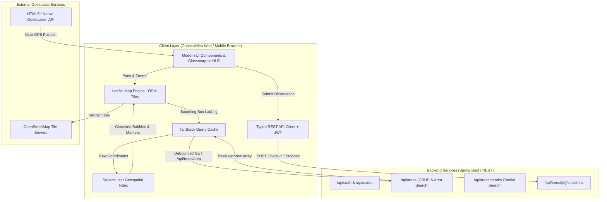
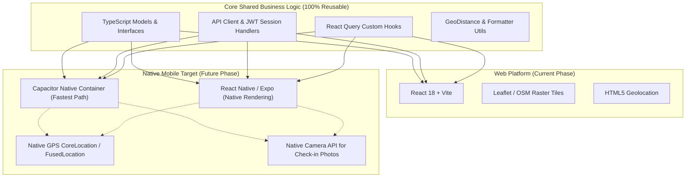

# Technical Documentation: CopaculMeu Web Client

**Project Name:** CopaculMeu (My Tree)  
**Document:** Frontend Architecture & Technical Specification  
**Version:** 1.0.0  
**Target Region:** Timișoara, Romania (`[45.75372, 21.22571]`)  
**Backend API Specification:** OpenAPI v3 (`http://localhost:8080/v3/api-docs`)  
**Core Principles:** 100% Open Technologies, Modern Aesthetic, Mobile-First Responsiveness, Cross-Platform Portability (React to Native Mobile).

---

## 1. Executive Summary & Vision

**CopaculMeu** is an open, citizen-driven urban forestry and ecological monitoring platform. It empowers citizens, volunteers, and municipal teams to:
1. **Explore & Visualize:** View an interactive, high-performance map of urban trees in Timișoara with real-time clustering.
2. **Inspect Tree Health:** Examine botanical data (species, age, height, trunk circumference, observed health, and watering status).
3. **Check-in & Care:** Submit on-site GPS-verified check-ins to record watering events, soil conditions, and visual observations.
4. **Propose & Expand:** Nominate newly planted or unmapped trees for administrative review.

This document establishes the frontend architecture for the web application, designed from day one to be responsive across desktop and mobile browsers, built strictly with open technologies, and structured to transition effortlessly into native mobile apps (via React Native or Capacitor).

---

## 2. Technology Stack & Architectural Decisions

| Layer | Selected Technology | Rationale & Open Standards |
|---|---|---|
| **Core Framework** | **React 18+ (TypeScript)** | Industry-standard component model, strict typing matching OpenAPI DTOs, and direct code reuse for native mobile development. |
| **Build Tool** | **Vite** | Ultra-fast Hot Module Replacement (HMR), optimized production tree-shaking, and lightweight zero-bloat bundling. |
| **Map Rendering Engine** | **Leaflet + MapLibre GL JS** (`@maplibre/maplibre-gl-leaflet`) | **100% Open Source** (BSD-3-Clause / BSD-2-Clause), zero vendor lock-in, zero proprietary API key requirements. MapLibre GL powers hardware-accelerated vector rendering and hillshading with Vite Web Worker, while Leaflet manages interactive cluster markers and UI layers. |
| **Map Style & Vector Provider** | **OpenMapTiles Terrain GL + OpenFreeMap** | **100% Free & Open:** Uses the official OpenMapTiles Terrain GL style (`openmaptiles/maptiler-terrain-gl-style`) adapted for open endpoints. Vector tiles are served via OpenFreeMap (`https://tiles.openfreemap.org/planet`), hillshading DEM via Mapterhorn (`tiles.mapterhorn.com`), and typography glyphs via OpenFreeMap Noto Sans. Zero API keys, zero watermarks, zero tracking. |
| **Clustering Engine** | **Supercluster** / **Leaflet.markercluster** | High-performance hierarchical k-d tree geospatial index. Handles tens of thousands of coordinates smoothly at 60 FPS. |
| **Styling & Design System** | **Modern Vanilla CSS / CSS Modules with Design Tokens** | Maximum control, zero runtime CSS-in-JS overhead, fluid typography, glassmorphism, responsive breakpoints, smooth micro-animations. |
| **Server State & Data Fetching** | **TanStack Query (React Query v5)** | Declarative asynchronous caching, automatic viewport-based debounced fetching, background cache invalidation, and optimistic updates for check-ins. |
| **HTTP Client** | **Typed Fetch / Axios Client** | Seamless integration with OpenAPI schemas, Bearer token interceptor, and unified error handling. |
| **Iconography** | **Lucide React** | Open-source (ISC license), sleek SVG icons for nature, water, GPS, health indicators, and navigation. |
| **Mobile Path** | **CapacitorJS / React Native** | Reusable business logic, TypeScript interfaces, and API services when shipping native iOS and Android binaries. |

---

## 3. System Architecture & Component Model



---

## 4. Map & Geospatial Specification (Feature #1)

### 4.1 Geographic Configuration (Timișoara, Romania)

*   **Default Map Center:**
    *   Latitude: `45.75372`
    *   Longitude: `21.22571`
    *   *Reference Landmark:* Piața Victoriei / Central Park, Timișoara
*   **Zoom Levels:**
    *   **Initial Default Zoom:** `14` (Neighborhood street-level view)
    *   **Min Zoom Limit:** `11` (Encompasses Greater Metropolitan Timișoara and surrounding green belts)
    *   **Max Zoom Limit:** `19` (High-resolution individual tree placement, down to single-meter accuracy)
*   **Default Bounding Box:**
    *   South (`minLat`): `45.6900`
    *   North (`maxLat`): `45.8200`
    *   West (`minLng`): `21.1400`
    *   East (`maxLng`): `21.3200`

### 4.2 Modern Bubble Clustering Algorithm & Behavior

To maintain optimal browser performance and avoid visual clutter when thousands of trees exist in an urban grid, trees are grouped dynamically into clusters:

1. **Spatial Aggregation:**
   * Trees within a defined pixel radius (e.g. 50–60px on screen) at a given zoom level are clustered.
   * As the user zooms in (levels 15–19), clusters break down into smaller sub-clusters and finally into individual tree markers.
2. **Visual Design of Cluster Bubbles:**
   * **Modern Glassmorphic Badge:** Translucent green glass container (`backdrop-filter: blur(8px); background: rgba(16, 185, 129, 0.85); box-shadow: 0 4px 16px rgba(16, 185, 129, 0.4)`).
   * **Dynamic Tier Styling based on Tree Count:**
     * *Small Cluster (2–9 trees):* Compact circular badge (36px), emerald tone.
     * *Medium Cluster (10–49 trees):* Medium badge (44px) with subtle ambient glow.
     * *Large Cluster (50+ trees):* Prominent badge (52px) with animated ripple pulse indicating dense urban canopies.
   * **Typography:** Bold, clean sans-serif numeral displaying the tree count.
3. **User Interaction:**
   * **Hover:** Gentle scale animation (`transform: scale(1.1)`), cursor turns to pointer.
   * **Click / Tap:** Automatically animates the map viewport by fitting the bounds of all trees inside that cluster (`map.fitBounds(cluster.getBounds())`).
   * **Spiderfy fallback:** If multiple trees share identical coordinates, clicking expands them into a radial spiderweb pattern.

### 4.3 Individual Tree Marker Aesthetics

When zoomed into single trees:
* **Custom SVG Tree Pin:** A circular pin containing an organic leaf icon.
* **Health Color-Coding:**
  * `EXCELLENT`: Deep Emerald Green (`#059669`)
  * `GOOD`: Bright Fresh Green (`#10b981`)
  * `FAIR`: Amber Gold (`#f59e0b`)
  * `POOR`: Warm Orange (`#f97316`)
  * `CRITICAL`: Crimson Rose (`#ef4444`)
  * `DEAD`: Muted Slate Gray (`#64748b`)
* **Urgent Care Indicator:** If `wateringLevel === 'CRITICAL_DROUGHT'`, a pulsing animated water droplet badge is overlaid on top of the pin.

---

## 5. Backend REST API Integration

The backend is exposed at `http://localhost:8080` and strictly adheres to the OpenAPI v3 contract.

### 5.1 Primary Endpoints

| Endpoint | Method | Security | Parameters | Purpose in Frontend |
|---|---|---|---|---|
| `/api/trees/area` | `GET` | Public | `minLat`, `maxLat`, `minLng`, `maxLng` | **Core Map Feeder:** Fetches all approved trees inside current visible map viewport. |
| `/api/trees/nearby` | `GET` | Public | `lat`, `lng`, `radiusMeters` (default 1000m) | **GPS Radar:** Finds trees immediately around user's current GPS position. |
| `/api/trees/{id}` | `GET` | Public | `id` (int64) | **Tree Profile:** Retrieves detailed botanical specs, history, and status. |
| `/api/trees/{id}/check-ins` | `GET` | Public | `id` (int64) | **Timeline:** History of volunteer observations, watering logs, and measurements. |
| `/api/trees/{id}/check-ins` | `POST` | Bearer Auth | Body: `TreeCheckinRequest` | **Submit Check-in:** Records user watering, soil condition, and updates tree status. |
| `/api/trees/propose` | `POST` | Bearer Auth | Body: `TreeCreateRequest` | **Citizen Proposal:** Propose a new tree for admin verification. |
| `/api/species` | `GET` | Public | None | **Species Catalog:** Returns all verified tree species (name, scientificName, commonName, aliases). **Cached on client for ≥ 30 minutes** (memory + `localStorage`) to eliminate redundant network roundtrips. |
| `/api/auth/login` | `POST` | Public | Body: `LoginRequest` | Authenticate user, returns JWT Bearer token and user info. |
| `/api/auth/me` | `GET` | Bearer Auth | Header: `Authorization` | Validates session and retrieves active profile. |

### 5.2 Key Data Models & TypeScript Contracts

#### `TreeResponse` (Tree Entity)
```typescript
export type HealthLevel = 'EXCELLENT' | 'GOOD' | 'FAIR' | 'POOR' | 'CRITICAL' | 'DEAD';
export type WateringLevel = 'CRITICAL_DROUGHT' | 'LOW' | 'MODERATE' | 'OPTIMAL' | 'OVERWATERED';
export type TreeStatus = 'APPROVED' | 'PENDING_APPROVAL' | 'REJECTED';

export interface TreeResponse {
  id: number;
  latitude: number;
  longitude: number;
  originalLatitude?: number;
  originalLongitude?: number;
  species: string;
  healthLevel: HealthLevel;
  wateringLevel: WateringLevel;
  lastWateredAt?: string | null; // ISO Date String
  height?: number | null;        // Meters
  age?: number | null;           // Years
  trunkCircumference?: number | null; // Centimeters
  locationDescription?: string | null;
  notes?: string | null;
  status: TreeStatus;
  proposedByUserId?: string | null;
  reviewedByUserId?: string | null;
  reviewedAt?: string | null;
  rejectionReason?: string | null;
  createdAt: string;
  updatedAt: string;
}
```

#### `TreeCheckinRequest` (Citizen Check-in Submission)
```typescript
export interface TreeCheckinRequest {
  latitude: number;       // User's current verified GPS latitude
  longitude: number;      // User's current verified GPS longitude
  watered: boolean;       // Did volunteer water the tree?
  wateringLevel: WateringLevel;
  proposedSpecies?: string;
  healthLevel?: HealthLevel;
  height?: number;
  age?: number;
  trunkCircumference?: number;
  locationDescription?: string;
  notes?: string;
}
```

#### `SpeciesResponse` (Tree Species Catalog)
```typescript
export interface SpeciesResponse {
  id: number;
  name: string;             // e.g. "Acer campestre (Jugastru)"
  scientificName?: string;   // e.g. "Acer campestre"
  commonName?: string;       // e.g. "Jugastru"
  aliases?: string;          // e.g. "Field maple"
}
```

### 5.3 Authentication & User Profile Models

#### `User` (Citizen Volunteer / Administrator)
```typescript
export interface User {
  id: string;                               // UUID v4
  email: string;
  name: string;
  role: 'USER' | 'ADMIN';
  status: 'UNCONFIRMED' | 'ACTIVE' | 'SUSPENDED';
  createdAt?: string;
  updatedAt?: string;
}
```

#### `LoginRequest` & `RegisterRequest`
```typescript
export interface LoginRequest {
  email: string;
  password: string;
}

export interface RegisterRequest {
  name: string;
  email: string;
  password: string;                         // Minimum 8 characters
}
```

#### `AuthResponse` (JWT Token Session)
```typescript
export interface AuthResponse {
  accessToken: string;                      // JWT Bearer token
  tokenType: string;                        // "Bearer"
  expiresIn: number;                        // Lifetime in seconds (86400)
  user: User;
}
```

> [!IMPORTANT]
> **Check-in GPS Validation Rule:**
> The backend calculates `deviationMeters` between the user's check-in GPS and the tree's recorded position. The check-in is flagged `valid: true` only if the deviation is within the strict threshold (typically ≤ 2.0 meters). The frontend UI must provide a live proximity indicator guiding the user close to the tree before enabling the check-in submission button.

---

## 6. Frontend Architecture & User Interface Design

### 6.1 Design System & Aesthetic Principles

*   **Palette:**
    *   Primary Brand: Emerald (`#10b981`), Deep Forest (`#064e3b`), Forest Leaf (`#059669`)
    *   Accents: Sky Water (`#0ea5e9`), Golden Sunlight (`#f59e0b`), Berry Red (`#f43f5e`)
    *   Surfaces: Frosted Glass (`rgba(255, 255, 255, 0.85)` with `backdrop-filter: blur(12px)` in light mode; `rgba(15, 23, 42, 0.85)` in dark mode)
    *   Text: Slate 900 (`#0f172a`), Slate 600 (`#475569`), and Slate 400 (`#94a3b8`)
*   **Typography:** Modern clean sans-serif (e.g. `Plus Jakarta Sans` or `Inter`) with distinct hierarchy.
*   **Micro-Interactions:** Subtle haptic-style transitions, floating cards with drop shadows (`0 8px 32px rgba(0,0,0,0.08)`), pulsing badges for critical drought warnings.

### 6.2 Responsive Layout Structure

```
+--------------------------------------------------------------------------+
|  CopaculMeu [Logo]         [Search Species / Street]       [User Profile] |
+--------------------------------------------------------------------------+
|                                                      |                   |
|                                                      |  DESKTOP SIDEBAR  |
|                                                      |  (Slide-in Panel) |
|                     FULL SCREEN                      |                   |
|                   INTERACTIVE MAP                    |  - Tree Details   |
|                                                      |  - Botanical Info |
|          [Cluster Bubble (42)]                       |  - Health Status  |
|                                                      |  - Watering State |
|                     (Tree Pin)                       |  - Last Watered   |
|                                                      |  - Check-in CTA   |
|                                                      |  - History Log    |
|  [Floating HUD: Locate Me | Filter | Legend]        |                   |
|                                                      |                   |
+--------------------------------------------------------------------------+
|  MOBILE BOTTOM SHEET: Slides up when tapping marker / cluster            |
+--------------------------------------------------------------------------+
```

*   **Desktop Experience:** Map occupies 100% of the viewport. When a tree is selected, an elegant glassmorphic sidebar slides in from the right without obscuring the tree pin.
*   **Mobile Experience:** Touch-optimized layout with gesture-friendly bottom sheet (expandable from peek height to full screen). Floating controls are placed within natural thumb reach.

### 6.3 Viewport Synchronization & Query Debounce Strategy

To prevent overloading the backend with REST requests during rapid panning or zooming:
1. Listen to Leaflet `moveend` and `zoomend` events.
2. Extract current bounding box: `bounds = map.getBounds()`.
3. Apply a **300ms debounce** timer before triggering `useQuery(['trees', 'area', bounds])`.
4. Add a **15% coordinate buffer** around the viewport so that minor panning loads immediately from cache without visual pop-in.

### 6.4 Two-Step Tree Proposal Wizard

To eliminate form clutter, prevent user input errors, and ensure centimeter-level geospatial precision:
1. **Step 1 — Adjust Position (`Ajustare Poziție GPS`):**
   * Automatically accesses hardware device GPS (`navigator.geolocation`) with high accuracy enabled.
   * Renders an interactive mini-map at zoom 22 (with raster tile overzooming `maxNativeZoom: 19`, `maxZoom: 22`) providing an intuitive ~77px diameter interactive zone.
   * Displays a prominent semi-transparent emerald circle (`fillColor: '#10b981'`, `fillOpacity: 0.32'`, `weight: 2.5`, dashed emerald border) with a soft glow, visibly delineating the 1.0-meter boundary around the device's central blue GPS anchor dot.
   * Smooth, jitter-free dragging: integrates Leaflet's `L.Draggable.on('predrag')` hook to clamp `_newPos` prior to DOM positioning, preventing coordinate oscillation or jumping.
   * Uses React mutable refs (`deviceBaseRef`, `onPositionChangeRef`) to eliminate stale closure bugs during asynchronous GPS acquisition.
   * Supports both click-to-move and drag-to-adjust, with automatic radial clamping: $\text{distance} \le 1.0\text{ m}$.
   * Shows a live readout of coordinates, fine adjustment distance in meters, and an instant reset button.
2. **Step 2 — Add Details (`Detalii Arbore`):**
   * Displays a confirmed coordinates summary card with a quick `[Modifică poziția]` link back to Step 1.
   * Features a custom theme-matched **Species Autocomplete Combobox** (`SpeciesSelect`):
     * Replaces un-stylable native browser `<datalist>` with custom eco-nature UI matching the app's emerald glassmorphic design system.
     * Accent/diacritic-insensitive instant search (e.g. typing `salcam` finds `Robinia pseudoacacia (Salcâm)`, `mesteacan` finds `Betula pendula (Mesteacăn)`).
     * Botanical dual-label presentation: bold Romanian common name + italic Latin scientific name, accompanied by soft emerald botanical avatars.
     * Full keyboard accessibility (`ArrowUp`/`ArrowDown`/`Enter`/`Escape`), outside-click dismissal, clear button (`X`), and animated dropdown chevron.
     * Seamless support for uncatalogued/novel species via `Folosește „...” ca specie nouă`.
   * Gathers tree health, watering level, height (m), estimated age (years), trunk circumference (cm), location landmarks, and visual notes.
   * Submits `TreeCreateRequest` to `/api/trees/propose` with zero manual coordinate typing.

### 6.5 User Authentication & Citizen Volunteer Profile Experience

To support community tree guardianship, check-ins, and verified proposals:
1. **JWT Session Lifecycle (`auth.ts` & `AuthContext.tsx`):**
   * Stores access tokens in `localStorage.getItem('token')`, automatically attached to backend API headers (`Authorization: Bearer <token>`).
   * Validates stored sessions on app mount via `GET /api/auth/me`. Expired or revoked tokens automatically clear the session.
   * Invalidates token server-side upon logout via `POST /api/auth/logout`.
2. **Dual-Mode Operation:**
   * **Live Mode:** Dispatches requests to the configured Spring Boot backend endpoints (`/api/auth/login`, `/api/users/register`, `/api/auth/me`, `/api/auth/logout`).
   * **Demo Mode:** Simulates immediate, local authentication and registration with mock volunteer profiles without requiring backend connectivity.
3. **Authentication & Email Confirmation Modal (`AuthModal.tsx`):**
   * Multi-view flow covering **Autentificare**, **Înregistrare**, and **Confirmare Email**.
   * Form validation with interactive password visibility toggles (`Eye`/`EyeOff`), minimum 8-character requirements, and matching password confirmations.
   * **Email Activation Screen (`confirm_email`):**
     * Automatically presented immediately following registration.
     * Displays target email address with quick inline edit option.
     * 6-cell numeric PIN code verification input with auto-advance, backspace navigation, and clipboard paste support.
     * Resend code button with 60-second cooldown timer.
     * Instant visual celebration screen (`CheckCircle2`) and automatic session login upon code validation.
   * Features a 1-click *"Autentificare rapidă cu profil voluntar demo"* button for instant review and testing.
4. **Header User Menu (`UserMenu.tsx`):**
   * Non-authenticated state: Prominent, clean *"Autentificare"* CTA in the header.
   * Authenticated state: Personalized avatar badge with volunteer initials (e.g. `MP`), first name, admin role indicator, and a floating dropdown menu for account overview and instant logout.

---

## 7. Cross-Platform Native Mobile Roadmap

One of the project's core directives is to ensure that mobile apps for iOS and Android can be created efficiently without rewriting core business logic.



### 7.1 Recommended Migration Paths

1. **Option A: Capacitor Container (Immediate & High Fidelity)**
   * Wrap the existing responsive Vite + React web application using `@capacitor/core`, `@capacitor/geolocation`, and `@capacitor/camera`.
   * **Advantages:** 95%+ code sharing, same Leaflet map UI, native access to high-precision hardware GPS and camera for capturing photo evidence during tree check-ins.
2. **Option B: React Native / Expo (Full Native UI)**
   * Share the headless layer (`api/`, `hooks/`, `types/`, `utils/`).
   * Replace Leaflet with `@maplibre/maplibre-react-native` or `react-native-maps` backed by OpenStreetMap vector/raster tile servers.

---

## 8. Frontend Project Organization

The planned workspace directory structure for the web client is organized by feature and separation of concerns:

```
c:\Projects\compacul_meu\CopaculMeu_web\
├── public/
│   ├── favicon.svg
│   └── tiles/                   # Offline tile fallback cache if needed
├── src/
│   ├── api/                     # REST Client & Endpoints
│   │   ├── client.ts            # Axios / Fetch client with Bearer auth interceptor
│   │   ├── trees.ts             # /api/trees, /api/trees/area, /api/trees/nearby
│   │   ├── checkins.ts          # /api/trees/{id}/check-ins
│   │   └── auth.ts              # /api/auth/login, /api/auth/me
│   ├── components/              # Shared UI Design System
│   │   ├── Button/
│   │   ├── Card/
│   │   ├── Modal/
│   │   ├── BottomSheet/         # Mobile-first swipeable sheet
│   │   └── Badges/              # Health & Watering status badges
│   ├── features/
│   │   ├── map/                 # Map Feature
│   │   │   ├── MapContainer.tsx # Core Leaflet / MapLibre canvas
│   │   │   ├── ClusterLayer.tsx # Supercluster bubble rendering
│   │   │   ├── TreeMarker.tsx   # Custom SVG tree pin
│   │   │   ├── UserMarker.tsx   # Live GPS blue pulse pin
│   │   │   ├── MapControls.tsx  # Locate me, zoom, layer controls
│   │   │   └── useMapBounds.ts  # Viewport bounding box hook
│   │   ├── tree-details/        # Selected Tree Inspection
│   │   │   ├── TreeDrawer.tsx   # Desktop slide-in / Mobile sheet
│   │   │   ├── HealthIndicator.tsx
│   │   │   └── HistoryList.tsx
│   │   ├── checkin/             # Tree Check-in & Watering Flow
│   │   │   ├── CheckinForm.tsx  # Form with GPS proximity validation
│   │   │   └── ProximityRadar.tsx # Visual indicator for ≤ 2m distance
│   │   └── auth/                # Login & User Context
│   ├── hooks/                   # Custom Utility Hooks
│   │   ├── useGeolocation.ts    # GPS tracking with high-accuracy mode
│   │   └── useDebounce.ts       # Debounce for map movement
│   ├── types/                   # TypeScript DTOs (matching OpenAPI spec)
│   │   ├── tree.ts
│   │   ├── checkin.ts
│   │   └── auth.ts
│   ├── styles/                  # Design System & Tokens
│   │   ├── tokens.css           # Colors, spacing, radii, typography, glassmorphism
│   │   ├── map.css              # Custom cluster bubbles & marker animations
│   │   └── index.css            # Base styles and resets
│   ├── App.tsx                  # Root Application & QueryClientProvider
│   └── main.tsx                 # Application Entrypoint
├── index.html
├── package.json
├── tsconfig.json
└── vite.config.ts
```

---

## 9. Implementation Roadmap & Milestones

### Phase 1: Foundation & Interactive Map (Current Milestone)
* Initialize React + TypeScript + Vite project in workspace.
* Configure Leaflet with 100% free OpenStreetMap Humanitarian (HOT) / Standard OSM tiles centered on Timișoara (`[45.75372, 21.22571]`).
* Implement Supercluster for modern, glowing glassmorphic bubble clusters.
* Connect to `/api/trees/area` with debounced bounding box queries.
* Implement user geolocation button ("Locate Me").

### Phase 2: Tree Detail Inspection & Filtering
* Build responsive slide-in sidebar (desktop) and swipeable bottom drawer (mobile).
* Display botanical info, estimated age, trunk circumference, and color-coded health/watering badges.
* Add map filter controls (Filter by Health Level, Drought Alert filter, Species search).

### Phase 3: GPS-Validated Check-in & Watering Workflow
* Implement HTML5 high-accuracy GPS capture.
* Build the `ProximityRadar` component calculating distance between user and selected tree.
* Submit `POST /api/trees/{id}/check-ins` with optimistic UI update and feedback.

### Phase 4: Citizen Tree Proposal & Contributor Flow
* Allow users to tap on the map to propose a new tree (`POST /api/trees/propose`).
* Provide species suggestions and camera photo upload support.

### Phase 5: Mobile Packaging & Distribution
* Configure Capacitor project for iOS and Android deployment.
* Enable offline tile caching and native push notifications for trees needing water.

---

## 10. Authentication & Citizen Action Authorization

Pentru a garanta calitatea datelor și prevenirea abuzurilor în monitorizarea ecologică a Timișoarei, anumite acțiuni sunt strict restricționate utilizatorilor înregistrați și autentificați:

### 10.1 Reguli de autorizare
1. **Navigare pe Hartă & Inspectare Arbori:**
   - **Publică (Anonim / Oaspeți):** Vizualizarea hărții, căutarea speciilor, filtrarea alertelor de secetă și inspectarea detaliilor oricărui arbore din `TreeDrawer` sunt deschise oricui.
2. **Propunerea unui Arbore Nou (`Propune Arbore`):**
   - **Rezervată utilizatorilor înregistrați:**
     - La apăsarea butonului din `Header` (`.propose-tree-btn`), utilizatorii neautentificați primesc direct dialogul `AuthModal` cu un banner contextual de notificare.
     - În `ProposeTreeModal`, există o barieră de securitate de rezervă (`propose-auth-guard-modal`) care redirecționează către autentificare dacă sesiunea lipsește.
3. **Fă Check-in & Înregistrează Udare (`POST /api/trees/{id}/check-ins`):**
   - **Rezervată utilizatorilor înregistrați:**
     - În panoul lateral/drawer `TreeDrawer`, dacă utilizatorul nu este autentificat, butonul de check-in este înlocuit cu cardul `.auth-required-checkin-card` ce explică clar cerința de securitate și oferă butonul direct `Conectează-te pentru Check-in`.
     - Dialogul de check-in include un ecran de gardă (`checkin-auth-modal`) ce împiedică transmiterea datelor fără token valid de autentificare.
   - **Limitare 24 de ore per arbore (`checkinLimit.ts`):**
     - **Regulă de business:** Un voluntar poate efectua check-in la mai mulți arbori distincți în aceeași zi, însă **același arbore poate primi check-in doar o singură dată la fiecare 24 de ore** din partea aceluiași utilizator (`${userId}:${treeId}`).
     - **Stare Cooldown:** Dacă utilizatorul a efectuat deja check-in pe arbore în ultimele 24 de ore, panoul `TreeDrawer` afișează automat cardul `.checkin-cooldown-card` cu un cronometru dinamic al timpului rămas (ex: *„Disponibil în: 23 ore și 45 min”*), iar butonul devine inactiv.
     - **Sincronizare:** Înregistrările sunt persistate în `localStorage` (`copaculmeu_user_tree_checkins`) și validate atât în interfață, cât și la nivel de API în funcția `submitTreeCheckin`.

---

## 11. Summary & Next Steps

This technical documentation provides a clear, comprehensive blueprint for building the **CopaculMeu** frontend using only open technologies, centered on Timișoara, with a responsive, modern glassmorphic interface and high-performance clustering.
